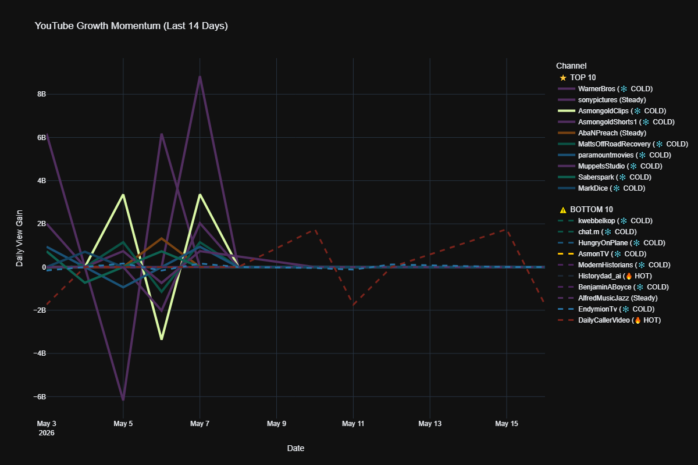
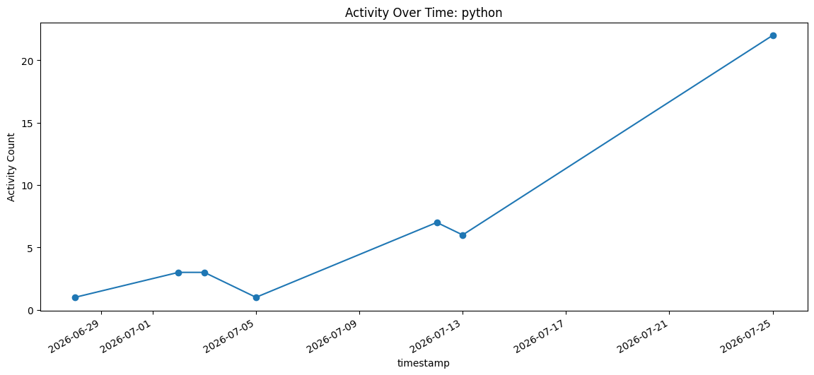

[](https://github.com/JaminShanti.png?size=240)

> Welcome to my retro for the `python` repo (master).

Profile: [https://www.linkedin.com/in/jamin-shanti](https://www.linkedin.com/in/jamin-shanti)

Repo: `git@github.com:JaminShanti/python.git` (branch: `master`)

---

## About Me

* Software developer focused on Python projects and tooling.
* This repository contains a collection of utility scripts for automation, data analysis, and system administration.
* For full professional details see the LinkedIn profile above.

## Recent Updates

* Added `review_mighty_meeply.py`, a Mighty Meeple inventory scanner that imports decklists, caches product data, and builds cart links for viable singles.
* Improved `mtg_scanner_tool.py` with stricter filtering for basic lands, decklist noise, and bracketed card names.
* Refreshed the repo layout and documentation so the MTG market tools and automation scripts are easier to discover and use.
* Improved music-part OCR to retry sparse pages and recognize Vocal/Voce labels from the instrument configuration.

## Table of Contents

- [Scripts Overview](#scripts-overview)
  - [Automation & System Administration](#automation--system-administration)
  - [Data Analysis & Reporting](#data-analysis--reporting)
  - [Market Monitoring & Hobby Projects](#market-monitoring--hobby-projects)
  - [Content Scraping & Analysis](#content-scraping--analysis)
  - [Document Processing](#document-processing)
  - [Miscellaneous](#miscellaneous)
- [How to Run](#how-to-run)
  - [System Prerequisites](#system-prerequisites-windows)
  - [Environment Setup](#environment-setup)
  - [Install Python Packages](#install-python-packages)
  - [Music sheet tools](#music-sheet-tools)
- [Testing](#testing)
- [Recent Commits](#recent-commits)

## Quick Start

1. **Clone the repository:**
   ```bash
   git clone git@github.com:JaminShanti/python.git
   cd python
   ```

2. **Install dependencies:**
   ```bash
   pip install -r requirements.txt
   ```

3. **Install development dependencies (optional, for testing):**
   ```bash
   pip install -r requirements-dev.txt
   ```

## Scripts Overview

### Automation & System Administration

* **`RecycleWebLogicServer.py`**: A robust script to manage WebLogic server instances (start, stop, restart, suspend, resume) via SSH, with parallel execution support.
* **`getWeblogicServerStatus.py`**: Retrieves the runtime status of WebLogic servers and clusters using WLST (WebLogic Scripting Tool) logic.
* **`svn_compare_f5.py`**: Compares F5 iRules deployed on a BigIP device against versions stored in an SVN repository to identify discrepancies.
* **`Backup_SFCC_S3.py`**: Automates backups or data transfers related to Salesforce Commerce Cloud (SFCC) and AWS S3.
* **`f5_node_health.py`**: Checks and reports on the health status of nodes within an F5 load balancer environment.

### Data Analysis & Reporting

* **`nyse_trending_report.py`**: Generates a high-performance dividend report for S&P 500, 400, and 600 stocks. Uses Yahoo Finance's bulk quote API for speed and exports reports as HTML/PDF.
* **`yt_channel_compare.py`**: Tracks and compares YouTube channel view counts over time with modern interactive visualizations.
  - Generates interactive **HTML** reports, as well as shareable **PNG** and **PDF** exports.
  - Features intelligent legend management (Top N channels) to ensure clarity in large datasets.
  - Supports standalone plot generation without re-fetching data via the `--plot` switch.
  - **Output Organization**: All generated files (daily stats, video trends, plots) are organized into `yt_cache/yt_stats_daily/`, `yt_output/yt_visuals/`, and `yt_output/yt_video_stats/` subdirectories respectively.
  - Built with **Plotly** for modern, interactive visualizations.
* **`rotten_tomato_user_reviews.py`**: Scrapes user reviews from Rotten Tomatoes for movies or TV shows, performs sentiment analysis (rating average), and generates word clouds.
* **`git_log_report.py`**: Analyzes a Git repository's history to generate reports on commit activity, authors, and file changes.
* **`corona_mapping.py`**: Visualizes COVID-19 data, likely creating choropleth maps (e.g., `covid_choropleth_*.html`) to show spread or impact by region.

### Example Outputs

 

 

### Market Monitoring & Hobby Projects

* **`mtg_dip_detector.py`**: Tracks the market value of Magic: The Gathering cards to detect price retracements and identify buying opportunities, particularly useful for monitoring Reserved List assets. Generates PDF and PNG reports of detected price dips.
* **`mtg_scanner_tool.py`**: A custom market data scanner designed to evaluate collection values and optimize deck builds for the Commander format (e.g., Rocco, Cabaretti Caterer).
  - Supports **caching** for faster subsequent runs.
  - Uses an external `excluded_cards.txt` file for easy management of cards to ignore.
  - Retrieves real-time pricing data from multiple sources.
  - Includes improved bracketed deck-entry handling and stricter filtering for unwanted basic-land / label noise.
  - Debug logging is off by default for clean deck output. To show deck parsing and lookup diagnostics, run:
    ```python
    python .\mtg_scanner_tool.py --debug
    ```
* **`review_mighty_meeply.py`**: Imports a decklist, harvests current inventory from Mighty Meeple, filters out unwanted names/conditions/basic lands, and produces cart permalinks for any matched single-card targets.

### Document Processing

* **`music_sheet_scripts\`**: Reviewed PDF part splitting, missing-part recovery,
  music inventories and chart-download tools. See the [music tools README](music_sheet_scripts/README.md).

### Content Scraping & Analysis

* **`hype_quote_scraper.py`**: Scrapes YouTube transcripts for specific keywords and hype-related phrases. Extracts matched quotes with timestamps and exports them to a text file for easy review and analysis.

### Miscellaneous

* **`lastgitcommit.py`**: A utility to retrieve details about the most recent Git commit.
* **`contact_bot/`**: A directory containing a bot implementation, possibly for automated messaging or interaction (e.g., Facebook Messenger).

## How to Run

This section provides instructions for setting up your environment and running the scripts.

### System Prerequisites (Windows)

Some scripts, particularly `music_sheet_scripts\music_part_splitter.py`, rely on external software for PDF and image processing. You **must** install these and ensure they are accessible via your Windows system's `PATH` environment variable.

1.  **Python 3.13+**:
    *   Download the latest Python installer from python.org.
    *   **IMPORTANT**: During installation, make sure to check the box that says "Add Python X.X to PATH".

2.  **Tesseract OCR Engine**:
    *   This is required by `pytesseract` for optical character recognition (OCR).
    *   Download the Windows installer from UB-Mannheim's GitHub releases. Choose the `tesseract-ocr-w64-setup-vX.XX.XX.exe` for 64-bit systems.
    *   During installation, ensure "Add to PATH" is selected.

3.  **Poppler for Windows**:
    *   This is required by `pdf2image` to convert PDF pages into images.
    *   Download the latest release (e.g., `poppler-X.XX.X_x64.zip`) from oschwartz10612's GitHub releases.
    *   Extract the downloaded ZIP file to a convenient location (e.g., `C:\Program Files\poppler-X.XX.X`).
    *   **Add Poppler's `bin` directory to your System PATH**:
        *   Search for "Environment Variables" in the Windows Start Menu and select "Edit the system environment variables".
        *   Click "Environment Variables..." button.
        *   Under "System variables", find and select the `Path` variable, then click "Edit...".
        *   Click "New" and add the full path to Poppler's `bin` directory (e.g., `C:\Program Files\poppler-X.XX.X\bin`).
        *   Click "OK" on all windows to save changes. You may need to restart your command prompt or IDE for changes to take effect.

### Environment Setup

*   `git` on PATH (usually installed with Git for Windows)

### Install Python Packages

Open your terminal or command prompt and run the following command to install all necessary Python libraries:

```bash
pip install gitpython pandas matplotlib plotly kaleido boto3 requests bigsuds PyYAML yfinance numpy tqdm pandas-datareader imgkit ipython paramiko wordcloud yagmail tabulate html2text fbchat playwright beautifulsoup4 PyPDF2 pdf2image pytesseract
playwright install chromium
```

### Music sheet tools

See [music_sheet_scripts/README.md](music_sheet_scripts/README.md) for the
reviewed splitting and Dropbox recovery workflows.

## Testing

This project uses **pytest** for unit testing. Development dependencies are managed in `requirements-dev.txt`.

To run the test suite:

```bash
pytest
```

To run tests with verbose output:

```bash
pytest -v
```

---

## Recent Commits

- **fc78174**: Add Mighty Meeple inventory scanning and MTG market tooling
- **23c4b22**: Add bracket 2/3 support for deck parsing
- **12d917a**: Update README for music splitter
- **6491c4b**: Update README for music splitter
- **69e8078**: Commit of Music Part Splitter
- **8517a56**: Improve OCR heuristics with smarter header scanning and alias handling
- **3f4ddc0**: Commit of Music Part Splitter
- **8d2ec23**: Commit of Music Part Splitter
